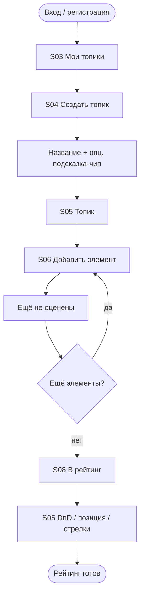
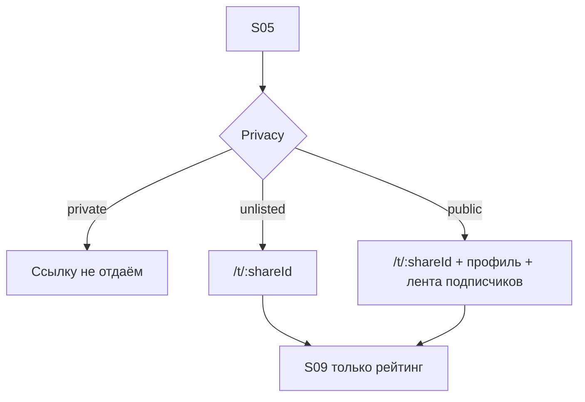
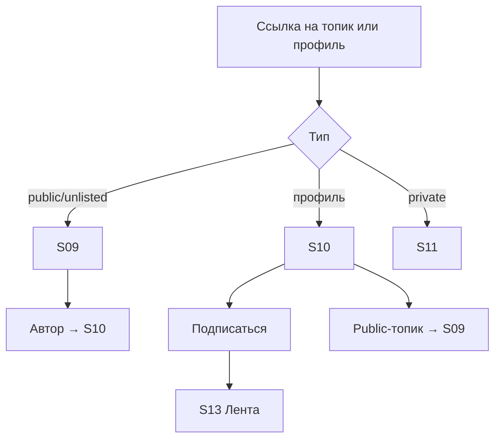
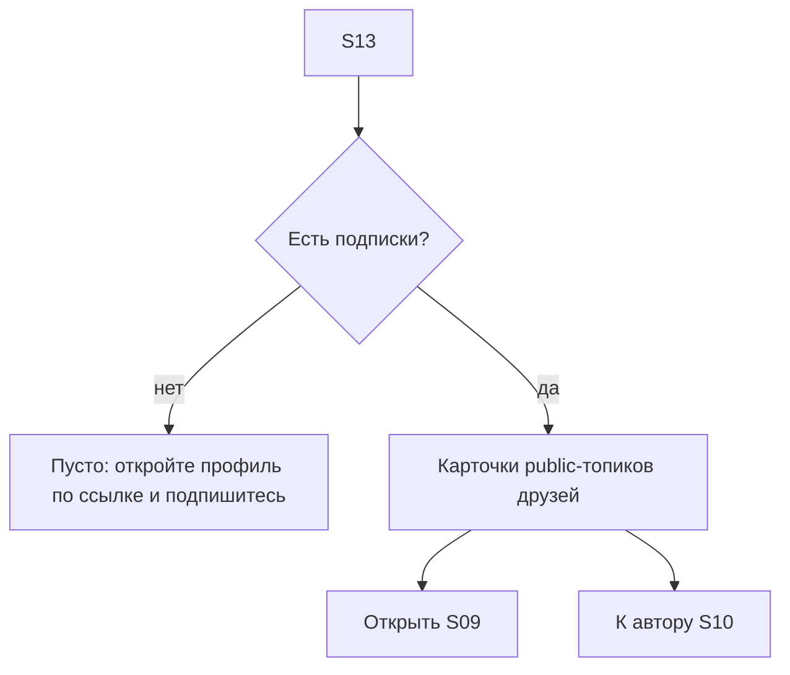
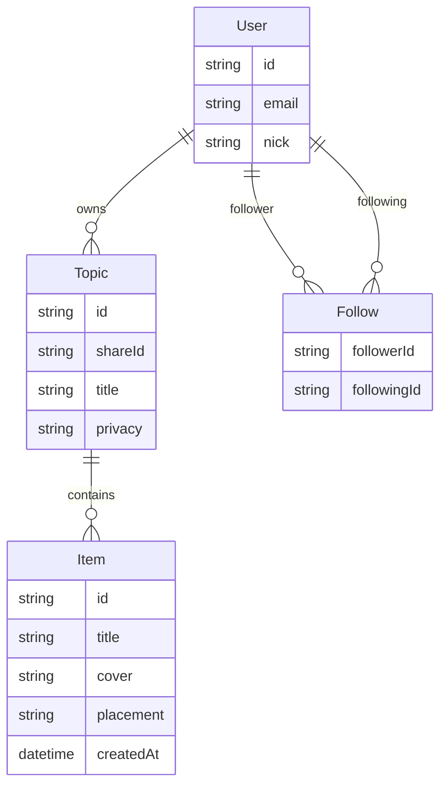

# Этап 1 — Концепция и информационная архитектура

> Статус: ✅ закрыт 03.10.2026.

Опора: [`stage-0-brainstorm.md`](stage-0-brainstorm.md), [`../process/decisions.md`](../process/decisions.md).  
Код, Figma-фреймы, схема БД Nest — **не** в этом документе.

---

## Цель этапа

Зафиксировать для MVP Topic:

1. карту экранов;
2. основные user flows;
3. продуктовую модель данных и правила видимости.

---

## 1. Карта экранов (sitemap)

Условные пути — продуктовые, не финальный роутинг.

```text
Topic (web / PWA)
│
├─ Гость
│  ├─ /                    → лендинг (S00)
│  ├─ /login               → вход
│  ├─ /register            → регистрация
│  ├─ /u/:nick             → публичный профиль
│  ├─ /t/:shareId          → просмотр топика (unlisted | public)
│  └─ /403 | «нет доступа» → private / чужой без прав
│
└─ Авторизованный
   ├─ /app                 → редирект: Мои топики (S03)
   ├─ /app/feed            → лента друзей (S13)
   ├─ /app/topics          → мои топики (S03)
   ├─ /app/topics/new      → создать топик
   ├─ /app/topics/:id      → топик владельца (inbox + ranked + шаринг)
   ├─ /app/topics/:id/items/new
   ├─ /app/topics/:id/items/:itemId
   ├─ /u/:nick             → профиль + подписка
   └─ /t/:shareId          → тот же share-view
```

### Каталог экранов MVP

| ID | Экран | Кто | Назначение |
|----|--------|-----|------------|
| S00 | Лендинг | гость | ценность продукта, CTA «Войти» / «Регистрация» |
| S01 | Вход | гость | email + пароль |
| S02 | Регистрация | гость | email + пароль + ник |
| S03 | Мои топики | владелец | список своих топиков, CTA «создать» |
| S04 | Создание топика | владелец | название; **подсказки** (Фильмы/… подставляют имя); privacy (дефолт unlisted); категории — позже |
| S05 | Топик (редактор) | владелец | «Ещё не оценены» + «Рейтинг»; шаринг/privacy |
| S06 | Добавление элемента | владелец | название, обложка; → inbox |
| S07 | Карточка элемента | владелец | правка; в рейтинг / обратно / удалить |
| S08 | Перенос в рейтинг | владелец | **отложено** (hi-fi не делаем; см. `ideas`) — дефолт «в конец» без модалки |
| S09 | Просмотр по ссылке | у кого есть URL | **только ranked** (inbox скрыт); unlisted \| public |
| S10 | Публичный профиль | все | **hi-fi отложено** (см. `ideas`); в IA пока остаётся — ник, public-топики, Подписаться / Отписаться |
| S11 | Нет доступа | все | private / нет прав |
| S12 | Не найдено | все | битая ссылка |
| S13 | Лента друзей | авторизованный | **hi-fi отложено** (см. `ideas`); в IA пока остаётся |

**Не в MVP:** онбординг-wizard, лайки/комменты, полный activity-stream по каждому DnD, глобальный поиск пользователей, сброс пароля (Should).

### Главная навигация (авторизованный)

- **Лента** (S13) · **Мои топики** (S03) · вход в свой профиль  
- После логина → **Мои топики** (ядро продукта). Лента — второй полюс, не пустой home у нового юзера.

---

## 2. User flows

### Flow A — Создать топик и выстроить рейтинг



**Правила:** новый элемент → unranked; ranked — строгий 1…N; DnD + позиция N + ↑↓. _(Позиция N и ↑↓ отложены в реализации 05.10.2026, см. `../process/decisions.md`.)_

### Flow B — Поделиться топиком



### Flow C — Открыть чужой контент и подписаться



### Flow D — Лента друзей



**Что такое лента в MVP (узко, чтобы успеть):**

- Не «каждый сдвиг DnD», а **лента public-топиков** пользователей, на которых вы подписаны.
- Сортировка: по `topic.updatedAt` (недавно обновлённые сверху).
- В карточке: автор, название топика, privacy=public (всегда), опционально топ-3 обложки / число элементов в рейтинге.
- **Unlisted и private в ленту не попадают** (иначе unlisted перестаёт быть «только по ссылке»).
- Подписка: с профиля S10. На себя подписаться нельзя. Счётчики подписчиков — nice-to-have, в MVP достаточно кнопки.

### Flow E — Конфликт правок

Устаревший save → «Топик изменился» → обновить → править снова. Без merge порядков.

_Отложено в реализации 05.10.2026 (первый slice без проверки версии); продуктовая договорённость не отменена, см. `../process/decisions.md`, `../backlog/ideas.md`._

---

## 3. Модель данных (продуктовая)



> `consumedAt` — не в MVP; см. [`docs/backlog/ideas.md`](../backlog/ideas.md).

### User

| Поле | Обяз. | Описание |
|------|-------|----------|
| id | да | |
| email | да | вход |
| nick | да | уникальный, в URL `/u/:nick`; **только латиница** (см.ниже) |

Без био/аватара в MVP.

#### Ник — решение

**Только латиница:** `a–z`, цифры, `_`; длина 3–30; в URL без percent-encoding; уникальность **case-insensitive**.

Кириллица в нике **не** допускаем (проще шаринг URL, нет омоглифов lat/cyr). Отображаемое имя на кириллице — не в MVP (при необходимости позже как отдельное поле `displayName`).


### Follow (подписка)

| Поле | Обяз. | Описание |
|------|-------|----------|
| followerId | да | кто подписывается |
| followingId | да | на кого |
| createdAt | да | |

Уникальная пара `(followerId, followingId)`; `followerId ≠ followingId`.

### Topic

| Поле | Обяз. | Описание |
|------|-------|----------|
| id | да | |
| shareId | да | для `/t/:shareId` |
| ownerId | да | |
| title | да | |
| privacy | да | `private` \| `unlisted` \| `public`; **default: unlisted** |
| createdAt / updatedAt | да | `updatedAt` двигает позицию в ленте друзей |

**Подсказки названия (MVP UI, не отдельная сущность):** чипы «Фильмы / Сериалы / Книги / Игры» на S04 только **подставляют текст в поле названия**. Пользователь может править свободно. Отдельный `presetKey` в модели **не обязателен** для MVP.

**Категории — позже** (идея): полноценная метка/таксономия топика, не путать с подсказкой имени.

Переименовать топик — можно всегда.

### Item

В UI и русской документации — **элемент** (временное имя; финальный термин — открытый вопрос). В модели/роутах пока `Item`.

| Поле | Обяз. | Описание |
|------|-------|----------|
| id | да | |
| topicId | да | |
| title | да | |
| cover | нет | upload |
| placement | да | `unranked` \| `ranked` |
| createdAt | да | дата добавления (система) |
| rankPosition | условно | только для `ranked`; в UI — плотный 1…N |

`consumedAt` (дата потребления, опц.) — **не в MVP**; зафиксировано в [`docs/backlog/ideas.md`](../backlog/ideas.md).

### Правила целостности

1. Элемент — в одном топике; новый → `unranked`.
2. Ranked — строгий полный порядок.
3. Каскадное удаление элементов с топиком.
4. Смена privacy не меняет `shareId`.
5. В ленту и профиль попадают только `public`-топики.
6. Подписка не даёт прав на private/unlisted.

### Матрица видимости

| Действие | private | unlisted | public |
|----------|---------|----------|--------|
| Владелец редактирует | да | да | да |
| `/t/:shareId` | нет | да | да |
| В `/u/:nick` | нет | нет | да |
| В ленте подписчиков (S13) | нет | нет | да |
| Inbox на S09 | — | **скрыт** | **скрыт** |

**S09 / inbox:** гостю и по шаринг-ссылке показываем **только рейтинг**. Inbox — черновик сравнений владельца; светить его на share-странице слабее и как «счастливый топ», и как приватность. Решение зафиксировано.

---

## 4. Состояния и копирайт (черновик)

| Контекст | Состояние | CTA / текст |
|----------|-----------|-------------|
| S00 | лендинг | ценность + вход / регистрация |
| S03 | нет топиков | «Создайте первый топик» |
| S05 | пусто | «Добавьте первый элемент» |
| S05 | только inbox | «Перенесите в рейтинг, когда будете готовы» |
| S09 | нет ranked | «Пока нечего показать» |
| S10 | нет public | «Пока нет открытых топиков» |
| S13 | нет подписок | «Откройте профиль друга по ссылке и нажмите Подписаться» |
| S13 | есть подписки, нет public-топиков | «Пока тихо — у друзей нет открытых топиков» |

Язык UI: русский. Продукт: **Topic**.

---

## 5. Экраны для Этапа 2 (приоритет макетов)

**Must hi-fi / wireframes**

1. S00 Лендинг  
2. S03 Мои топики  
3. S04 Создание топика  
4. S05 Редактор топика  
5. S06 / S07 Элемент  
6. S09 Share-view  
7. S10 Профиль + подписка — **hi-fi отложено**  
8. S13 Лента друзей — **hi-fi отложено**  

**Low-fi достаточно:** S01/S02, S08 (модал), S11/S12.

---

## 6. Закрытые вопросы этапа

| # | Решение |
|---|---------|
| 1 Лендинг | **Да**, отдельный S00 |
| 2 Inbox на S09 | **Скрыт**; на шаринге только рейтинг |
| 3 consumedAt | **Не в MVP**; отложено в `ideas` (04.10.2026; ранее: опционально) |
| 4 Ник | **Только латиница** (`a–z`, цифры, `_`); unique case-insensitive |
| 5 Пресет / подсказки | UI: чипы-подсказки к **названию**; категории — post-MVP. Отдельный preset в модели не нужен |
| Лента | **В MVP**: подписка + лента public-топиков друзей (не activity по каждому DnD) |

### Ещё открыто (не блокеры)

- Нужны ли на S13 фильтры / «только обновлённые за неделю» — скорее post-MVP.
- Показывать ли топ-N обложек в карточке ленты — решить на дизайне.

---

## Следующий шаг

Этап 1 закрыт. Дальше — **Этап 2** (дизайн): [`stage-2-brainstorm.md`](stage-2-brainstorm.md).
